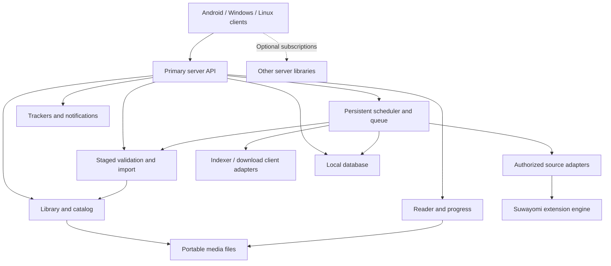

# Proposed architecture

The approved baseline uses .NET 10 / ASP.NET Core, React/TypeScript and SQLite in local appdata. One primary on Windows or Linux, including Unraid Docker, owns the main library, scheduling and progress validation. Android, Windows and Linux connect as clients. The shared WebUI is the initial client candidate. [Approved baseline](IMPLEMENTATION-DECISIONS.md) · [Server and client responsibilities](REMOTE-READING.md)

Modules: catalog, scanner, file organizer, duplicate index and resolution planner, import planner, policy/scoring, queue, reader, auth, progress, integrations, diagnostics, backups. Start modular monolith; Suwayomi is the proposed isolated extension service, optional external clients. Versioned adapter contracts: metadata lookup; source search/list/fetch; extension install/configure; indexer search; download submit/status/cancel; import plan/commit; progress and notifications.

Canonical data: work -> edition (language/publication/version) -> volume/chapter identity -> release (group/source/quality/coverage) -> file (root-relative path, format, hashes, ownership/provenance) -> page manifest. A file can cover many chapters and a chapter many releases. Use exact decimal/part identities, never float or title-only merges. Users hold independent progress, bookmarks, permissions. Jobs have retries and idempotency keys.

## File organization and duplicate management (required)

See [FILE-ORGANIZATION.md](FILE-ORGANIZATION.md). One physical-file inventory and fingerprint index shared by scanning, importing, renaming and deduplication. Separate file identity (path and filesystem object), content identity (hashes and ordered page manifests), and bibliographic identity (work/edition/chapter/coverage). A read-only scan produces proposals; a permission-checked executor revalidates identity, coverage, mount and target state before any mutation. Journal operations, stage cross-filesystem copies, preserve references, quarantine where permitted and support recovery. Neither Windows remote client nor another worker may mutate server files independently.

## Proposed Unraid library layout

| Host example | Container | Purpose |
| --- | --- | --- |
| /mnt/user/appdata/manga-organizer | /config | local DB/config/backups/cache; suitable local disk, not SMB/NFS |
| /mnt/user/data | /data | common mount for library/downloads |
| /mnt/user/data/media/manga | /data/media/manga | library, read-only adoption initially |
| /mnt/user/data/downloads/manga | /data/downloads/manga | completed downloads |
| separate engine appdata | engine config | Suwayomi isolated data |

Single /data mount permits hardlink attempts only on same real filesystem; verify actual Unraid storage/share behavior, explicit copy fallback. Example UID/GID 99:100, umask 002; no recursive permission changes. Proposed configurable port 8787; LAN first, HTTPS proxy remote, no default password. amd64 first, arm64 after qualification, Community Applications XML after image works. No placeholder Compose or fake image.

Windows: installer/portable proposal, AppData config, chosen roots, loopback default, optional tray, long/UNC paths, case collisions/locks/reserved names. Remote client uses TLS and protected tokens; no live SQLite on SMB. Suwayomi external or managed process for local mode subject to packaging test. Offline client cache separate; explicit progress conflict handling.

## Safety

Dry-run adoption/rename, managed roots opt-in, stage/verify before atomic publish; never overwrite ambiguous files; protect seeding hardlinks and page provenance, durable jobs. Reject archive traversal/bombs, symlink escapes, oversized resources. Missing or unexpectedly empty mount fences mutations, never mass delete. Quarantine/restore, consistent DB+secrets+version backup, restore/rollback tests. Nonroot, scoped auth, CSRF/host validation, encrypted integration secrets, masked logs, outbound URL validation, per-source limits. Authorized content only. License review before external datasets/models or upstream code.

## Pass 7 packaging constraints

[Deployment qualification](source-audit/DEPLOYMENT-QUALIFICATION.md) compares Windows native tray and Electron wrappers, Docker runtime permissions and target fixture gates. Proposed port and framework remain unapproved. DB local appdata; explicit nonroot runtime and no recursive media chown; one data mount for eligible hardlinks, verify actual filesystem; signed installer/update and artifact-specific SBOM before release. All tests not run.
