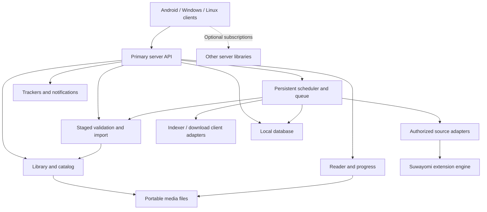

# Proposed architecture

The approved baseline uses .NET 10 / ASP.NET Core, React/TypeScript and SQLite in local appdata. One primary on Windows or Linux, including Unraid Docker, owns the main library, scheduling and progress validation. Android, Windows and Linux connect as clients. The shared WebUI is the initial client candidate. [Approved baseline](IMPLEMENTATION-DECISIONS.md) · [Server and client responsibilities](REMOTE-READING.md)

Modules: catalog, scanner, file organizer, duplicate index and resolution planner, import planner, policy/scoring, queue, reader, auth, progress, integrations, diagnostics, backups. Start modular monolith; Suwayomi is the proposed isolated extension service, optional external clients. Versioned adapter contracts: metadata lookup; source search/list/fetch; extension install/configure; indexer search; download submit/status/cancel; import plan/commit; progress and notifications.

Use stable work and chapter IDs with exact numbering, edition-specific mappings and volume membership. Store physical locations, verified content identity and release records separately. Version release coverage and page boundaries independently. Preserve progress during moves and retain provenance with associations. Users have independent progress and permissions, and jobs support retries and idempotency keys. [Catalog identity](RELEASE-IDENTITY.md) · [Reader mapping](READING-CONTINUITY.md)

## WebUI design requirements

- Use Tailwind CSS for new and updated WebUI styles. Define shared colors and breakpoints in the Tailwind theme. Keep layout utilities with the component they style and centralize shared rules.
- Use Lucide for interface icons. Keep visible labels on navigation items, hide decorative icons from assistive technology and give icon-only controls an accessible name.
- Reuse React components for repeated controls and layouts. Extend them with named style variants, optional icons, native element props and composable content as needed. Keep semantic elements, visible keyboard focus and responsive behavior across variants.
- Use the shared accessible select for dropdowns. Keep action buttons at their intrinsic size and wrap action groups when horizontal space is limited.
- Use one set of destinations for the desktop sidebar and the compact phone navigation. A future Android app shares the destinations, labels, matching review and reader interaction patterns. Both clients use the primary server's library identities and progress state. [Client responsibilities](REMOTE-READING.md#server-and-client-responsibilities)

Use the INK//SHELF palette, shared shell, and screen patterns for the functional WebUI and upcoming reader. [UI design](UI-DESIGN.md)

## File organization and duplicate management (required)

One physical-file inventory and fingerprint index serves scanning, importing, renaming and deduplication. Read-only discovery proposes actions. The primary’s executor revalidates identity, resulting coverage, mounts and destination state before mutations. Journal operations and stage cross-filesystem copies. The expanded executor publishes to managed trash, supports restore and limits expiration to committed, deliberately trashed entries. The primary remains the sole mutation authority. [Inventory and file operations](FILE-ORGANIZATION.md) · [Trash and duplicate rules](DUPLICATE-AND-TRASH.md)

## Proposed Unraid library layout

| Host example | Container | Purpose |
| --- | --- | --- |
| /mnt/user/appdata/manga-organizer | /config | local DB/config/backups/cache; suitable local disk, not SMB/NFS |
| /mnt/user/data | /data | common mount for library/downloads |
| /mnt/user/data/media/manga | /data/media/manga | library, read-only adoption initially |
| /mnt/user/data/downloads/manga | /data/downloads/manga | completed downloads |
| separate engine appdata | engine config | Suwayomi isolated data |

Single /data mount permits hardlink attempts only on same real filesystem; verify actual Unraid storage/share behavior, explicit copy fallback. Example UID/GID 99:100, umask 002; no recursive permission changes. Proposed configurable port 8787; LAN first, HTTPS proxy remote, no default password. amd64 first, arm64 after qualification, Community Applications XML after image works. No placeholder Compose or fake image.

Windows: installer/portable proposal, AppData config, chosen roots, loopback default, optional tray, long/UNC paths, case collisions/locks/reserved names. Remote client uses TLS and protected tokens; no live SQLite on SMB. Suwayomi external or managed process for local mode subject to packaging test. Offline client cache separate; explicit progress conflict handling.

## Safety

Preview adoption and rename, opt in each managed root, and verify staging before no-clobber publication. Protect hardlinks and page provenance with durable jobs. Reject traversal, oversized resources and symlink escapes. Missing and unexpectedly empty mounts fence mutations. Require consistent database, config and identity backups and rehearsal for incompatible upgrades. Run non-root where supported, use scoped auth and CSRF/host validation, protect secrets, mask logs, validate outbound URLs and enforce source limits. Review licenses before using external data, models or code. [Upgrade recovery](UPGRADE-RECOVERY.md)

## Pass 7 packaging constraints

[Deployment qualification](source-audit/DEPLOYMENT-QUALIFICATION.md) compares Windows native tray and Electron wrappers, Docker runtime permissions and target fixture gates. Proposed port and framework remain unapproved. DB local appdata; explicit nonroot runtime and no recursive media chown; one data mount for eligible hardlinks, verify actual filesystem; signed installer/update and artifact-specific SBOM before release. All tests not run.
